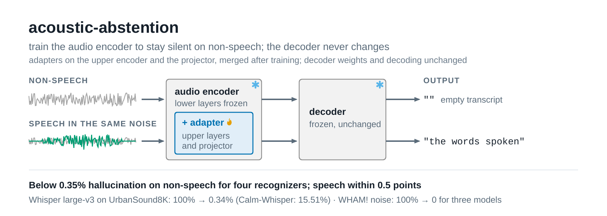
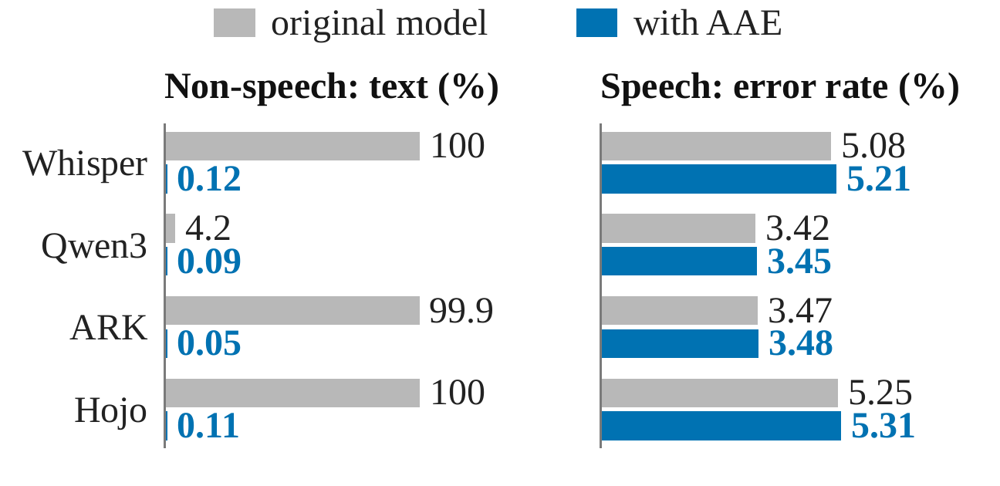

<p align="center">
  <picture>
    <source media="(prefers-color-scheme: dark)" srcset="assets/figures/hero-dark.png">
    
  </picture>
</p>

# acoustic-abstention

*Learning When to Stay Silent: Acoustic Abstention Encoding for Automatic Speech Recognition*

Aditya Pujari and Ajita Rattani, University of North Texas


[](https://huggingface.co/RootAccess4Life/acoustic-abstention)

> 📦 Checkpoints: **[RootAccess4Life/acoustic-abstention](https://huggingface.co/RootAccess4Life/acoustic-abstention)** holds 24 checkpoints: the
> released model for each ASR model ([whisper-large-v3/aae](https://huggingface.co/RootAccess4Life/acoustic-abstention/tree/main/whisper-large-v3/aae) &nbsp;·&nbsp;
> [qwen3-asr-1.7b/aae](https://huggingface.co/RootAccess4Life/acoustic-abstention/tree/main/qwen3-asr-1.7b/aae) &nbsp;·&nbsp;
> [ark-asr-3b/aae](https://huggingface.co/RootAccess4Life/acoustic-abstention/tree/main/ark-asr-3b/aae) &nbsp;·&nbsp;
> [hojo-asr-v1/aae](https://huggingface.co/RootAccess4Life/acoustic-abstention/tree/main/hojo-asr-v1/aae)), the four
> variants of the ablation study for each, and the ablation's full-recipe rows where they differ from the released
> model: the other Hojo-ASR-V1 run (`hojo-asr-v1/aae-run1`) and Whisper large-v3 at 8,500 steps
> (`whisper-large-v3/aae-8500`), and the decoder-adaptation control, Whisper large-v3's decoder adapted at AAE's
> parameter count with a KL term at two weights (`whisper-large-v3/decoder-kl`, `whisper-large-v3/decoder-kl-1`). All
> are sha256-pinned in `aae/weights.py`; fetch with `python scripts/download_weights.py`.

**Learn when to stay silent: fine-tune the audio encoder, keep the decoder frozen.** Automatic speech recognition (ASR)
models can hallucinate transcripts from non-speech audio such as noise and music. Acoustic Abstention Encoding (AAE)
fine-tunes a pretrained ASR model's audio encoder while its text decoder stays frozen: an abstention loss makes the
decoder return an empty transcript for non-speech, and a feature-preservation loss keeps the encoder's features of
speech-containing audio close to the original encoder's. Training needs no speech transcripts, and inference needs no
added module.

**On the complete UrbanSound8K, WHAM! and filtered FSD50K sets, AAE reduces hallucination to at most 0.34% for all four
ASR models, whose original rates are 99.8% to 100% (Whisper large-v3, ARK-ASR-3B, Hojo-ASR-V1) and 0.59% to 9.20%
(Qwen3-ASR-1.7B). Under greedy decoding, all 24 speech error rates stay within 0.5 points of the original models**
([results](#results)). Every number in this repository covers a complete evaluation set.

```bash
git clone https://github.com/pujariaditya/acoustic-abstention && cd acoustic-abstention
./setup.sh                                          # two pinned environments + the four original ASR models
envs/main/bin/python scripts/download_weights.py --variant aae
envs/main/bin/python -m aae.transcribe --model whisper-large-v3 noise.wav speech.wav
```

`aae.transcribe` decodes your own files with the original model and with the checkpoint, side by side.

**What "the decoder never changes" means, exactly.** The adapters sit in the last half of the encoder blocks and, for
the audio-LLMs, in the audio projector. After training they are merged into the weights (W ← W + (α/r)BA), and a
checkpoint stores only the tensors that changed (0.31 to 0.81 GB). Every decoder weight, the architecture and the
parameter count are those of the original model, and the decoding procedure (prompt, greedy search, token limit) is the
same for the original model and the checkpoint. What changes is what the decoder is given to read. The
`decoder-adapter` and `decoder-kl` checkpoints (0.42 to 1.89 GB) are the exceptions, by design: they are the decoder
edits of the ablation study.

## Method

<p align="center">
  <picture>
    <source media="(prefers-color-scheme: dark)" srcset="assets/figures/method-dark.png">
    
  </picture>
</p>

***Example of AAE training on Whisper large-v3.** ❶ Inputs pair non-speech n with speech-containing m. ❷ The frozen
teacher processes m; ❸ the student, with LoRA on blocks 16–31, processes both. ❹ The preservation loss aligns their
features on the non-padding frames of m. ❺ The abstention loss targets the end-of-text (EOT) token through the frozen
decoder for n. ❻ Adapters update every eight units. For the audio-LLMs, the projector also carries adapters, and the
target is each model's own empty answer followed by its end-of-turn token.*

A frozen teacher and an adapter-equipped student read audio through the same pretrained encoder E and, for the
audio-LLMs, the projector P that maps encoder features to the dimension the decoder D expects (for Whisper, P is the
identity). The teacher gives the features $F_0(x) = P(E(x))$; the student gives $F_\theta(x)$ through the same path with
LoRA adapters ($r = 16$, $\alpha = 32$) on the attention and feed-forward layers of the last half of the encoder blocks
and, for the audio-LLMs, on P. Only the adapters $\theta$ are trained; every original weight, including the decoder's,
stays frozen. The teacher is the same network with the adapters off, so no second copy is kept.

Each training pair holds a non-speech segment $n$ and a speech-containing input $m$ built from a speech utterance $s$,
whose transcript is not used: $m$ is clean $s$ (probability 0.2), $s$ mixed with $n$ (0.4), or $s$ followed by 0.3 to
1.5 s of silence and the first 1 to 4 s of $n$ (0.4), at an SNR drawn uniformly from -5 to 20 dB. The **abstention
loss** is the frozen decoder's cross-entropy for an empty transcript $\varnothing$ after the model's prompt $y_0$, given
the student's features of $n$ (for Whisper, `<|eot|>` after `<|sot|><|en|><|transcribe|><|0.00|>`):

$$\mathcal{L}_{\mathrm{abs}} = -\log p_D\big(\varnothing \mid y_0, F_\theta(n)\big)$$

The **feature-preservation loss**, following LDIFS, keeps the student's features of $m$ close to the teacher's, frame by
frame over the non-padding frames $\mathcal{T}$:

$$\mathcal{L}_{\mathrm{pres}} = \frac{1}{|\mathcal{T}|} \sum_{t \in \mathcal{T}} \frac{\lVert F_{\theta,t}(m) - F_{0,t}(m) \rVert_2^2}{\lVert F_{0,t}(m) \rVert_2^2}, \qquad \mathcal{L} = \mathcal{L}_{\mathrm{abs}} + 50\, \mathcal{L}_{\mathrm{pres}}$$

Because $m$ holds the same non-speech segment that the abstention loss silences, the encoder cannot lower both losses by
reacting to that sound alone: it has to respond to the presence of speech. With the decoder frozen, features that stay
in place keep the transcript in place; [docs/RESULTS.md](docs/RESULTS.md#5-why-the-encoder-encoder-edit-versus-decoder-edit-on-whisper-large-v3)
states the margin argument and measures it on Whisper large-v3.

## Results

<p align="center">
  <picture>
    <source media="(prefers-color-scheme: dark)" srcset="assets/figures/results-dark.png">
    
  </picture>
</p>

Hallucination rate (HR, %: non-speech segments that receive any text), original model → with AAE (Whisper large-v3:
9,250 steps; Hojo-ASR-V1: the run with higher rates):

| model | UrbanSound8K (8,732) | WHAM! noise (8,000) | filtered FSD50K (6,414) |
|---|---|---|---|
| Whisper large-v3 | 100.00 → **0.34** | 100.00 → **0.00** | 100.00 → **0.02** |
| Qwen3-ASR-1.7B | 2.68 → **0.11** | 9.20 → **0.03** | 0.59 → **0.12** |
| ARK-ASR-3B | 99.86 → **0.11** | 100.00 → **0.00** | 99.81 → **0.03** |
| Hojo-ASR-V1 | 99.99 → **0.18** | 100.00 → **0.00** | 99.98 → **0.14** |

Filtered FSD50K keeps the evaluation segments without a label under the AudioSet *Human voice* or *Music* subtrees. On
sets from outside the training sources (1,000 segments each of digital silence, white noise and pink noise, and 3,955
non-vocal NSynth notes), the original models write text on up to 100% of the segments, and AAE on none
([detail](docs/RESULTS.md#out-of-domain-non-speech)).

Speech error rate (WER; CER for the Mandarin sets), original model → with AAE, on the complete test sets, and *same*:
the share of the model's 15,680 normalized transcripts identical to the original model's:

| model | LibriSpeech clean | other | tail | 5 dB | FLEURS Mandarin | AISHELL-1 | same |
|---|---|---|---|---|---|---|---|
| Whisper large-v3 | 2.15 → 2.15 | 4.02 → 4.07 | 3.44 → 3.57 | 5.17 → 5.62 | 7.60 → 7.72 | 8.10 → 8.10 | 97.0 |
| Qwen3-ASR-1.7B | 1.71 → 1.71 | 3.47 → 3.53 | 2.61 → 2.63 | 4.02 → 3.86 | 7.19 → 7.44 | 1.53 → 1.50 | 97.7 |
| ARK-ASR-3B | 1.43 → 1.43 | 2.84 → 2.84 | 2.01 → 2.07 | 3.96 → 3.98 | 8.76 → 8.75 | 1.83 → 1.83 | 99.0 |
| Hojo-ASR-V1 | 1.79 → 1.80 | 4.01 → 4.07 | 3.04 → 3.06 | 5.71 → 5.78 | 15.22 → 15.44 | 1.71 → 1.71 | 96.6 |

*tail*: a LibriSpeech test utterance, 1 s of silence, then 3 s of noise; *5 dB*: noise added at 5 dB SNR (1,000
utterances each). Every increase is within its tolerance fixed in advance (+0.3 WER test-clean, +0.5 test-other, +1.0
on each noisy set, +1.0 CER on each Mandarin set). Paired bootstrap 95% intervals keep 22 of the 24 changes below their
tolerance, and with WHAM! noise recordings held out from training, mixed into the same 1,000 utterances, the largest
change is +0.21 WER ([detail](docs/RESULTS.md#2-speech-accuracy-on-the-complete-test-sets)).

**Speech preservation depends on noise and decoding.** At -5 dB SNR, AAE returns empty transcripts for 2.4% to 6.0% of
the speech utterances, against at most 1.0% for the original models; at 5 and 15 dB, at most 0.15%
([detail](docs/RESULTS.md#6-low-snr-stress-test)). With the default decoding of Whisper and Hojo-ASR-V1, AAE still
reduces HR from 39.71% to 100% to at most 0.26%, and the speech changes stay within tolerance except for Hojo-ASR-V1 on
FLEURS (+3.53 CER), where beam search answers three Mandarin utterances in English and repeats a word in a fourth;
without these four of 945 utterances, the change is -0.10 ([detail](docs/RESULTS.md#default-decoding)).

Whisper large-v3 on UrbanSound8K, each published method under its own definition of a hallucination and AAE under all
three, from one decoding pass; ΔWER: change in LibriSpeech test-clean and test-other WER against the respective original
model; †: published:

| definition | system | HR, system | HR, original | ΔWER clean | ΔWER other |
|---|---|---|---|---|---|
| any text | Calm-Whisper † | 15.51 | 99.97 | +0.07 | +0.06 |
| any text | Silero VAD gate | 3.22 | 100.00 | 0.00 | 0.00 |
| any text | **AAE** | **0.34** | 100.00 | **0.00** | **+0.05** |
| skip rule | SAE steering † | 19.88 | 95.98 | +1.59 | +3.56 |
| skip rule | **AAE** | **0.34** | 92.34 | 0.00 | +0.05 |
| p_ns ≤ 0.6 | HSP † | 0.87 | 76.08 | +8.89 | +7.26 |
| p_ns ≤ 0.6 | HSP, gated † | 2.74 | 76.08 | +2.11 | +0.70 |
| p_ns ≤ 0.6 | **AAE** | **0.34** | 78.46 | 0.00 | +0.05 |

*Any text* (Calm-Whisper, and the definition used everywhere else in this repository) counts every output with text;
*skip rule* (SAE steering) counts text kept by Whisper's skip rule, which drops an output when its no-speech probability
p_ns exceeds 0.6 and its mean log-probability is at most -1; *p_ns ≤ 0.6* (HSP) counts text with p_ns at most 0.6. Empty
outputs count as non-hallucinatory even when the skip rule keeps them. Calm-Whisper fine-tunes selected decoder heads,
SAE steering shifts encoder activations at inference, and HSP projects decoder activations out of a hallucination
subspace at inference; their numbers are quoted from each paper, not re-run, and our original-model rates are within
3.64 points of the published ones ([detail](docs/RESULTS.md#3-comparison-with-published-results)). A Silero VAD gate in
front of the original models passes every speech utterance but leaves text on 0.17% to 3.22% of the non-speech
segments; AAE leaves less on all 12 model and set pairs ([detail](docs/RESULTS.md#gating-with-a-voice-activity-detector)).

## Ablation study

Each variant removes or replaces one component; every row trains for 8,500 steps (for Whisper large-v3, the full-recipe
row is the released run at that step, `whisper-large-v3/aae-8500`; for Hojo-ASR-V1, the other run,
`hojo-asr-v1/aae-run1`) and is evaluated on the complete sets. Mean HR over the three non-speech sets (%) / *same* (%),
and in parentheses the number of the six speech sets beyond their tolerance; bold: every speech set within its
tolerance:

| variant | Whisper large-v3 | Qwen3-ASR-1.7B | ARK-ASR-3B | Hojo-ASR-V1 |
|---|---|---|---|---|
| AAE | **0.35 / 96.6** | **0.09 / 97.7** | **0.05 / 99.0** | **0.06 / 96.6** |
| λ = 0: no preservation loss | 0.00 / 0.0 (6) | 0.00 / 0.0 (6) | 0.00 / 1.5 (6) | 0.00 / 0.0 (6) |
| CE on m: transcript cross-entropy instead | 0.18 / 70.2 (2) | 0.04 / 81.3 (3) | 0.12 / 85.6 (2) | 0.02 / 78.3 (2) |
| indep. noise: another segment in m | **0.03 / 92.5** | **0.08 / 97.8** | **0.39 / 99.2** | **0.04 / 96.6** |
| dec. adapters: CE-trained, in the decoder | **1.09 / 76.4** | 0.35 / 85.0 (2) | **0.05 / 87.3** | 0.06 / 81.1 (3) |

**Feature preservation.** Without it, all four models return empty transcripts for at least 98.4% of the speech
utterances. Cross-entropy on m toward the original model's transcript of s reduces hallucinations but keeps far fewer
transcripts the same, as do CE-trained decoder adapters. On Whisper large-v3, the decoder's hidden vector at the decision
step (the first step after the prompt, where the decoder chooses between writing text and ending the transcript) shows
why: AAE moves non-speech (median relative change 135.5%) while speech stays in place (4.0%), whereas both CE-trained
models also move speech (106.3% and 106.4%) ([detail](docs/RESULTS.md#where-each-edit-acts-the-decoders-decision-state)).

**Decoder adaptation.** Adapting Whisper large-v3's decoder instead of its encoder at AAE's parameter count (5.90M: LoRA
of rank 18 in the decoder's self-attention, trained with the abstention loss plus λ·KL(p_0 ‖ p_θ) on m) meets the
speech tolerances at λ = 50 and λ = 1 but leaves UrbanSound8K HRs of 4.59% and 2.45%, against AAE's 0.94% at 8,500
steps ([detail](docs/RESULTS.md#a-decoder-edit-with-output-preservation-whisper-large-v3)).

**Shared-noise pairing.** Mixing the speech in m with a different, independently drawn segment instead of the n that the
abstention loss silences keeps every speech set within tolerance, but 14 Whisper large-v3 and 9 Hojo-ASR-V1 utterances
of 15,680 come out empty, against two each with AAE, while the effects on HR and *same* vary across models. The per-set
results and the limitations are in [docs/RESULTS.md](docs/RESULTS.md).

## Reproduce the paper

```bash
./setup.sh
envs/main/bin/python scripts/fetch_data.py --data-root ~/corpora   # the public corpora (~95 GB of archives)
envs/main/bin/python -m aae.prepare --data-root ~/corpora          # stage 61,244 clips (23 GB), each checked against its digest
envs/main/bin/python scripts/download_weights.py                   # all 24 checkpoints, ~15.7 GB, sha256-verified
./scripts/reproduce.sh                                             # every evaluation, then the tables
```

`reproduce.sh` runs every evaluation on the complete sets and ends with `python -m aae.report`, which prints every table
of [docs/RESULTS.md](docs/RESULTS.md) with each of its 1153 numbers compared against the paper's value
(`assets/paper_results.json`). The inputs are pinned end to end: clip lists, order and batching durations ship in
`assets/manifests`; every staged clip is checked against the digest of the audio the paper's numbers came from; the
noisy test sets and their held-out-noise versions are rebuilt from an explicit recipe (bit-identical on all 4,000
clips); the ASR models are pinned to exact revisions; and `requirements.txt` pins the direct dependencies each
environment ran with. No corpus audio is redistributed, and the original ASR models are downloaded from their
publishers; the checkpoints hold only the merged weights of the adapted layers.

## Train

```bash
envs/main/bin/python -m aae.prepare --data-root ~/corpora --sets train
./scripts/train.sh whisper-large-v3 aae        # the exact arguments of a released checkpoint
```

`configs/checkpoints.yaml` lists the arguments of all 24 checkpoints (`whisper-large-v3/aae-8500` is the released
Whisper large-v3 run at 8,500 steps). The four released models took 10.6 to 26.2 hours of wall-clock time each, and the
other 19 runs 2.5 to 24.0 hours, on one Quadro RTX 8000 shared with other jobs (`wallclock_s` in each `training.json`).
GPU training is not bit-deterministic, so a retrained checkpoint differs from the released one in bytes and its numbers
can differ slightly; retraining was not repeated for this release.

## Where to go next

| | |
|---|---|
| [docs/RESULTS.md](docs/RESULTS.md) | every number, the command that reproduces it, the release checks and what is not measured |
| [configs/checkpoints.yaml](configs/checkpoints.yaml) | the training arguments of all 24 released checkpoints |
| [aae/](aae/) | the package: each step (prepare, evaluate, crosswalk, stress, locus, separability, states, vad, train, report, transcribe) runs with `python -m aae.<step>` |
| [assets/figures/](assets/figures/) | the figures of this page (PNG, light and dark) and of the paper (PDF) |

Two Python environments are needed because the ASR models' own code needs incompatible transformers releases
(Qwen3-ASR is native in transformers 5; ARK-ASR's remote code and `hojo-asr` are written for transformers 4). Both
install the same `requirements.txt`; its Python-version markers select the pins. Evaluation needs a CUDA device.

Paths default to the repository (`data/`, `models/`, `checkpoints/`) and can be moved with `AAE_DATA`, `AAE_MODELS`
and `AAE_WEIGHTS`; `AAE_HF_REPO` names the checkpoint repository, and `AAE_GPU_FRACTION` caps the share of GPU memory
a run may use.

## Citation

See `CITATION.cff`. Please also cite the ASR models and corpora you use, and Calm-Whisper
([Wang et al., Interspeech 2025](https://www.isca-archive.org/interspeech_2025/wang25b_interspeech.html)), whose
definition of the hallucination rate this work adopts.

## License

MIT (`LICENSE`). The checkpoints are derived weights of their base models and follow their licenses: Whisper large-v3
(MIT), Qwen3-ASR-1.7B, ARK-ASR-3B and Hojo-ASR-V1 (Apache-2.0). They were trained on audio from WHAM! noise, FSD50K,
MUSAN, ESC-50, DEMAND, LibriSpeech, FLEURS and AISHELL-1, each under its own terms; some are non-commercial (ESC-50
is CC BY-NC 3.0, and FSD50K clips carry per-clip Creative Commons licenses, some of them CC BY-NC). No corpus is
redistributed: `scripts/fetch_data.py` fetches UrbanSound8K, AISHELL-1 and the FSD50K development clips from Hugging
Face mirrors and the other corpora from their publishers.
