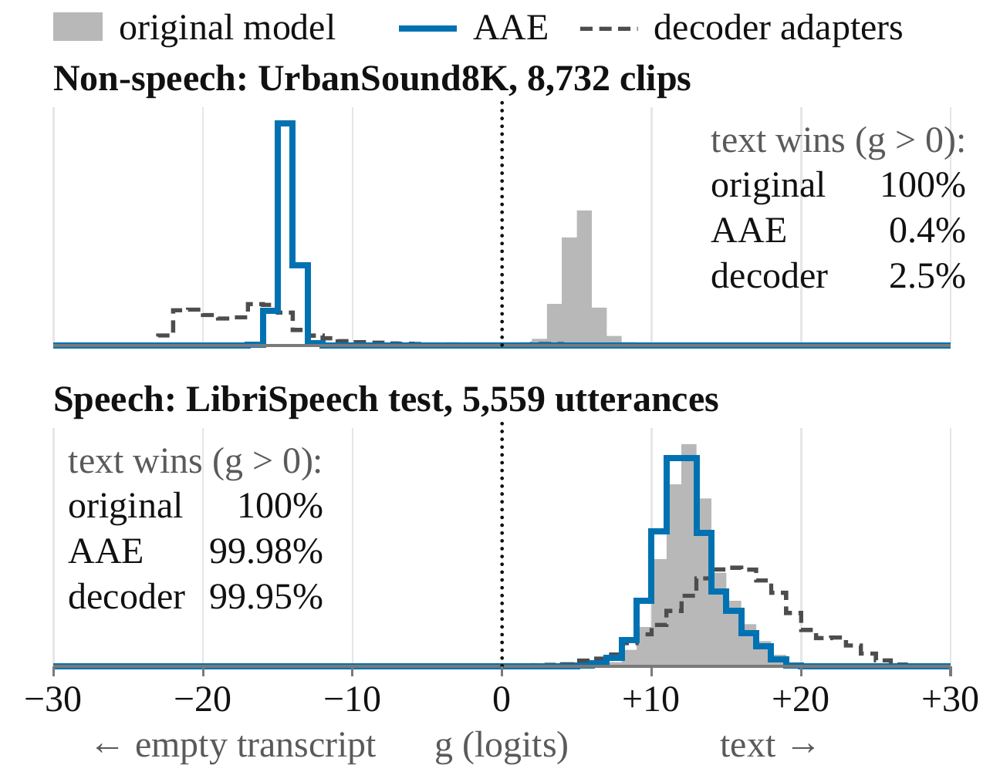
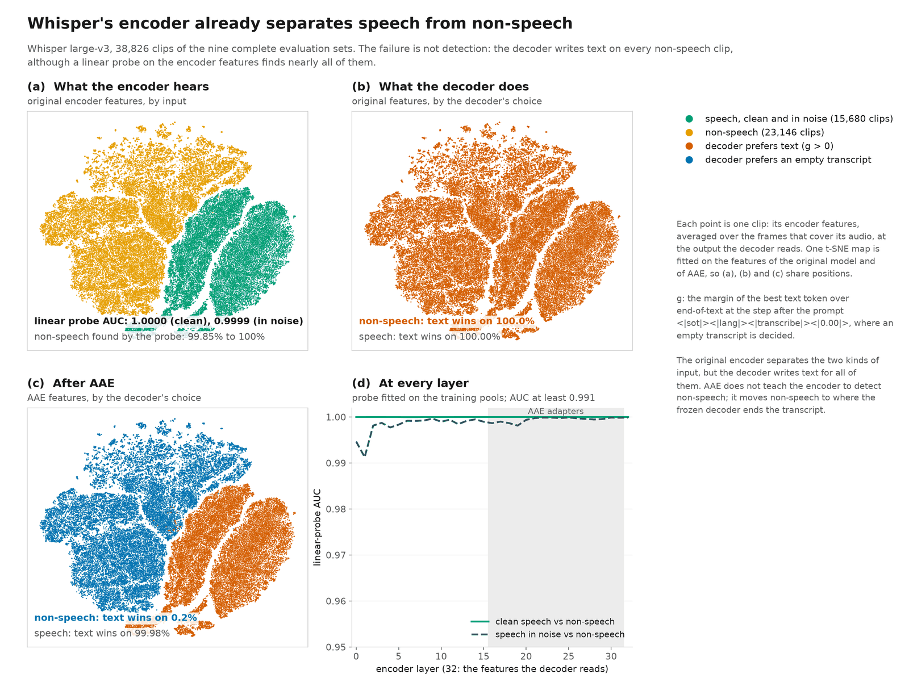
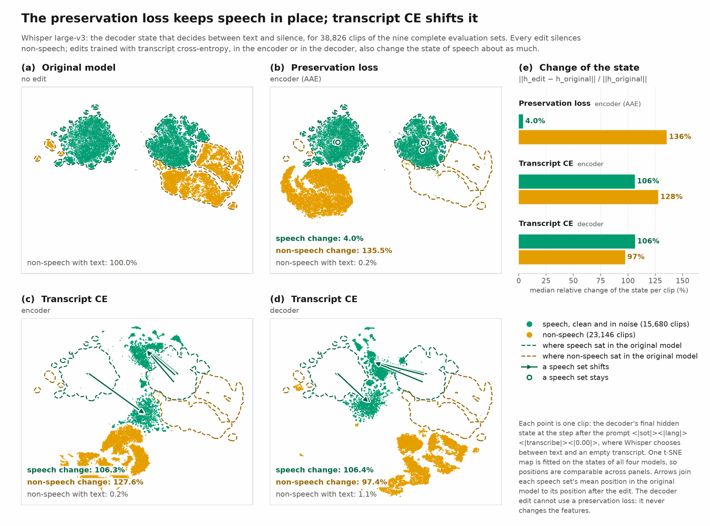

# Results

Every number in this document comes from the evaluation outputs behind the paper, and every number covers every clip
or utterance of its evaluation set. Each section names the command of this repository that reproduces it. `python -m aae.report` prints every table below from a set of runs and compares each of
its 1153 numbers with `assets/paper_results.json`; on the paper's recorded outputs, all 1153 are identical
([section 9](#9-release-checks)). [Section 3](#3-comparison-with-published-results) quotes other papers' numbers
without re-running them.

**Definitions.** The hallucination rate (HR) is the percentage of non-speech clips for which the model returns any
non-whitespace text, as in Calm-Whisper. WER uses Whisper's English normalizer; CER uses its basic normalizer, OpenCC
traditional-to-simplified conversion and no whitespace. *Same* counts the transcripts that are identical to the
original model's after that normalization. Speech accuracy is preserved when every set stays within a tolerance fixed
before the experiments: +0.3 WER on test-clean, +0.5 on test-other, +1.0 on each noisy set and +1.0 CER on each
Mandarin set.

**Sets.** Non-speech: all 8,732 UrbanSound8K clips, all 8,000 WHAM! noise clips outside its training split, and the
6,414 of the 10,231 FSD50K evaluation clips without a label in the AudioSet *Human voice* or *Music* subtrees
(filtered FSD50K). Speech: LibriSpeech test-clean (2,620) and test-other (2,939), FLEURS Mandarin test (945),
AISHELL-1 test (7,176), and two noisy sets built from the same 1,000 LibriSpeech test utterances, spread across
speakers and each paired with a WHAM! training or MUSAN noise clip: *tail* appends 1 s of silence and 3 s of the noise
at the utterance's RMS level, and *5 dB* adds the noise at 5 dB SNR. Their held-out-noise versions mix the same
utterances the same way with WHAM! recordings from its evaluation splits, which no model saw in training.

| section | what it holds |
|---|---|
| [1. Hallucination](#1-hallucination-on-the-complete-non-speech-sets) | counts, 95% intervals, unfiltered FSD50K, test clips cut from training recordings |
| [2. Speech accuracy](#2-speech-accuracy-on-the-complete-test-sets) | error rates, identical transcripts, empty outputs |
| [3. Published results](#3-comparison-with-published-results) | Whisper large-v3 under each paper's definition |
| [4. Ablation study](#4-ablation-study) | each component removed or replaced, per model and per set |
| [5. Why the encoder](#5-why-the-encoder-encoder-edit-versus-decoder-edit-on-whisper-large-v3) | the margin argument, measured on Whisper large-v3; speech and non-speech in the original encoder; where each edit acts |
| [6. Low SNR](#6-low-snr-stress-test) | the complete test-other and FLEURS Mandarin sets at -5, 5 and 15 dB |
| [7. Remaining outputs](#7-remaining-outputs-on-urbansound8k) | UrbanSound8K clips that still receive text, by class |
| [8. Training](#8-training) | adapters, data, steps and hours |
| [9. Release checks](#9-release-checks) | what was re-run with this code |
| [10. Not measured](#10-what-is-not-measured) | the limits of these results |

---

## 1. Hallucination on the complete non-speech sets

```bash
STAGES=complete ./scripts/reproduce.sh
```

Clips that receive any text, with the rate (%) in parentheses, and the 95% Wilson interval of the rate with AAE:

| | original model | AAE | AAE, 95% interval (%) |
|---|---|---|---|
| ***UrbanSound8K, 8,732 clips*** | | | |
| Whisper large-v3 | 8,732 (100.00) | 30 (0.34) | 0.24–0.49 |
| Qwen3-ASR-1.7B | 234 (2.68) | 10 (0.11) | 0.06–0.21 |
| ARK-ASR-3B | 8,720 (99.86) | 10 (0.11) | 0.06–0.21 |
| Hojo-ASR-V1 | 8,731 (99.99) | 16 (0.18) | 0.11–0.30 |
| ***WHAM! noise, 8,000 clips*** | | | |
| Whisper large-v3 | 8,000 (100.00) | 0 (0.00) | 0.00–0.05 |
| Qwen3-ASR-1.7B | 736 (9.20) | 2 (0.03) | 0.01–0.09 |
| ARK-ASR-3B | 8,000 (100.00) | 0 (0.00) | 0.00–0.05 |
| Hojo-ASR-V1 | 8,000 (100.00) | 0 (0.00) | 0.00–0.05 |
| ***FSD50K, filtered, 6,414 clips*** | | | |
| Whisper large-v3 | 6,414 (100.00) | 1 (0.02) | 0.00–0.09 |
| Qwen3-ASR-1.7B | 38 (0.59) | 8 (0.12) | 0.06–0.25 |
| ARK-ASR-3B | 6,402 (99.81) | 2 (0.03) | 0.01–0.11 |
| Hojo-ASR-V1 | 6,413 (99.98) | 9 (0.14) | 0.07–0.27 |
| ***FSD50K, all evaluation clips, 10,231 clips*** | | | |
| Whisper large-v3 | 10,231 (100.00) | 218 (2.13) | 1.87–2.43 |
| Qwen3-ASR-1.7B | 666 (6.51) | 287 (2.81) | 2.50–3.14 |
| ARK-ASR-3B | 10,197 (99.67) | 215 (2.10) | 1.84–2.40 |
| Hojo-ASR-V1 | 10,231 (100.00) | 279 (2.73) | 2.43–3.06 |

With AAE, every model and set stays below 0.35%. The highest rate is 0.34%, Whisper large-v3 on UrbanSound8K
(30 of 8,732 clips), and the upper end of a 95% interval is at most 0.49%. On WHAM! noise, three of the four
models return no text for any clip. Qwen3-ASR-1.7B hallucinates less to begin with (0.59% to 9.20%), and AAE
lowers its rates to 0.03% to 0.12%. On the unfiltered FSD50K evaluation set, which includes speech, singing and
music, 2.1% to 2.8% of clips receive text with AAE, part of which can be a correct transcription.

**Some non-speech test clips come from training recordings.** FSD50K and ESC-50 training clips are deduplicated
against the evaluation sets by Freesound id. MUSAN noise carries no Freesound ids, and an acoustic fingerprint search
(landmark hashing, every candidate confirmed by waveform correlation) finds 220 evaluation clips cut from
131 of its 930 recordings: 105 UrbanSound8K slices (1.2%) and 115 FSD50K evaluation clips, 107 of
them in filtered FSD50K (1.7%). None of them receives text from any model with AAE, and excluding them changes
each AAE rate by less than 0.005 points (`python -m aae.report` prints this check). The clips are listed in
`assets/manifests/musan_overlap.csv`.

### Out-of-domain non-speech

```bash
python -m aae.ood --nsynth data/raw/nsynth/nsynth-test     # then: aae.evaluate --legs silence,white_noise,pink_noise,nsynth
```

Sets from outside the sources of the training pools (`python -m aae.ood`): 1,000 clips each of digital silence, white noise and pink noise (1 to 10 s, -60 to -20 dBFS), and the 3,955 NSynth test notes outside its vocal family. HR (%), original model / AAE:

| model | digital silence | white noise | pink noise | NSynth notes |
|---|---|---|---|---|
| Whisper large-v3 | 100.00 / 0.00 | 100.00 / 0.00 | 100.00 / 0.00 | 100.00 / 0.00 |
| Qwen3-ASR-1.7B | 0.00 / 0.00 | 0.00 / 0.00 | 3.10 / 0.00 | 0.00 / 0.00 |
| ARK-ASR-3B | 100.00 / 0.00 | 97.30 / 0.00 | 97.30 / 0.00 | 100.00 / 0.00 |
| Hojo-ASR-V1 | 100.00 / 0.00 | 100.00 / 0.00 | 100.00 / 0.00 | 100.00 / 0.00 |

With AAE, the models return text for 0 of their 27,820 clips (6,955 per model). For a rate of 0, the 95% interval ends at 0.38% on a 1,000-clip set and at 0.10% on NSynth.

---

## 2. Speech accuracy on the complete test sets

```bash
STAGES=complete ./scripts/reproduce.sh
```

WER (CER for the Mandarin sets); *same*: transcripts identical to the original model's (%); *empty*: utterances
returned empty, original model / AAE:

| model | | clean | other | tail | 5 dB | FLEURS | AISHELL-1 |
|---|---|---|---|---|---|---|---|
| Whisper large-v3 | original model | 2.15 | 4.02 | 3.44 | 5.17 | 7.60 | 8.10 |
| | AAE | 2.15 | 4.07 | 3.57 | 5.62 | 7.72 | 8.10 |
| | same (%) | 98.9 | 96.5 | 96.7 | 95.1 | 95.0 | 97.0 |
| | empty | 0 / 0 | 0 / 1 | 0 / 0 | 0 / 0 | 0 / 0 | 0 / 2 |
| Qwen3-ASR-1.7B | original model | 1.71 | 3.47 | 2.61 | 4.02 | 7.19 | 1.53 |
| | AAE | 1.71 | 3.53 | 2.63 | 3.86 | 7.44 | 1.50 |
| | same (%) | 98.5 | 95.3 | 97.7 | 95.4 | 97.1 | 98.8 |
| | empty | 0 / 0 | 0 / 0 | 0 / 0 | 0 / 0 | 0 / 0 | 0 / 0 |
| ARK-ASR-3B | original model | 1.43 | 2.84 | 2.01 | 3.96 | 8.76 | 1.83 |
| | AAE | 1.43 | 2.84 | 2.07 | 3.98 | 8.75 | 1.83 |
| | same (%) | 99.3 | 98.7 | 98.6 | 97.1 | 98.7 | 99.4 |
| | empty | 0 / 0 | 0 / 0 | 0 / 0 | 0 / 0 | 0 / 0 | 0 / 0 |
| Hojo-ASR-V1 | original model | 1.79 | 4.01 | 3.04 | 5.71 | 15.22 | 1.71 |
| | AAE | 1.80 | 4.07 | 3.06 | 5.78 | 15.44 | 1.71 |
| | same (%) | 97.9 | 94.0 | 94.7 | 88.9 | 94.8 | 98.7 |
| | empty | 0 / 0 | 0 / 0 | 0 / 0 | 0 / 0 | 0 / 0 | 0 / 0 |

All 24 model and set pairs stay within 0.5 points of the original model, and 23 change by at most 0.25 points.
The largest increase is 0.45 WER, Whisper large-v3 on the 5 dB set; some rates improve, by up to 0.16 points.
After normalization, 96.6% to 99.0% of each model's 15,680 transcripts are identical to the original model's, and the
share per set ranges from 88.9% (Hojo-ASR-V1, 5 dB) to 99.4%. AAE returns an empty output for one of 2,939
test-other and two of 7,176 AISHELL-1 utterances with Whisper large-v3, and for none with the other models; the original
models return none.

**How certain each change is.** Paired bootstrap 95% intervals of each change in points: 10,000 draws of the
utterances with replacement, both systems scored on every draw (`aae.metrics.change_interval`):

| model | clean | other | tail | 5 dB | FLEURS | AISHELL-1 |
|---|---|---|---|---|---|---|
| Whisper large-v3 | -0.02 to +0.02 | -0.02 to +0.12 | -0.16 to +0.53 | +0.11 to +1.03 | -0.01 to +0.32 | -0.05 to +0.05 |
| Qwen3-ASR-1.7B | -0.02 to +0.03 | 0.00 to +0.12 | -0.03 to +0.06 | -0.24 to -0.07 | -0.14 to +0.92 | -0.06 to -0.01 |
| ARK-ASR-3B | -0.02 to +0.01 | -0.03 to +0.03 | 0.00 to +0.15 | -0.04 to +0.07 | -0.03 to +0.02 | -0.01 to +0.02 |
| Hojo-ASR-V1 | -0.02 to +0.05 | -0.02 to +0.12 | -0.07 to +0.12 | -0.07 to +0.21 | -1.05 to +1.55 | -0.03 to +0.02 |

The upper limit lies below the tolerance on 22 of the 24 pairs; the exceptions are Whisper large-v3 on the 5 dB set
(+0.11 to +1.03) and Hojo-ASR-V1 on FLEURS Mandarin (-1.05 to +1.55), whose interval is the widest.

### Speech with held-out noise

```bash
STAGES=heldout ./scripts/reproduce.sh
```

The noise of *tail* and *5 dB* comes from the WHAM! and MUSAN pools that AAE trains on, so those sets measure speech
preservation under noise recordings seen in training. Their held-out versions mix the same 1,000 utterances the same
way with WHAM! noise from its evaluation splits (`assets/manifests/complete/*_heldout.jsonl`), recordings that no model
saw in training; they are of the same kind as the training noise, not new noise types:

| model | set | original model | AAE | change (95% interval) | same |
|---|---|---|---|---|---|
| Whisper large-v3 | tail, held-out noise | 3.34 | 3.36 | +0.02 (-0.18 to +0.25) | 96.7 |
|  | 5 dB, held-out noise | 5.17 | 5.38 | +0.21 (-0.06 to +0.72) | 95.9 |
| Qwen3-ASR-1.7B | tail, held-out noise | 2.46 | 2.48 | +0.02 (-0.03 to +0.07) | 97.4 |
|  | 5 dB, held-out noise | 3.72 | 3.64 | -0.08 (-0.16 to -0.01) | 94.9 |
| ARK-ASR-3B | tail, held-out noise | 2.02 | 2.05 | +0.03 (-0.01 to +0.07) | 98.8 |
|  | 5 dB, held-out noise | 3.74 | 3.72 | -0.02 (-0.11 to +0.04) | 97.7 |
| Hojo-ASR-V1 | tail, held-out noise | 2.95 | 2.91 | -0.04 (-0.13 to +0.05) | 94.8 |
|  | 5 dB, held-out noise | 5.46 | 5.43 | -0.03 (-0.17 to +0.10) | 91.2 |

The largest increase is 0.21 WER, every upper limit is at most 0.72, and 91.2% to 98.8% of transcripts
are identical to the original model's. [Section 6](#6-low-snr-stress-test) mixes the complete test-other and FLEURS
Mandarin sets with training-pool noise at lower SNRs.

### Default decoding

```bash
python -m aae.evaluate --model whisper-large-v3 --checkpoint whisper-large-v3/aae --decoding default --out ...   # and --original
python -m aae.evaluate --model hojo-asr-v1 --checkpoint hojo-asr-v1/aae --decoding default --out ...              # legacy env
```

Whisper large-v3 with `whisper.transcribe` and its defaults (temperature fallback, the skip rule, conditioning on previous text), and Hojo-ASR-V1 with its released 4-beam search (repetition penalty 2.0); original model and AAE. HR (%) on the non-speech sets, WER or CER (%) on the speech sets, and *same*: transcripts identical to the original model's under the same decoding (%):

| model | | UrbanSound8K | WHAM! noise | FSD50K | clean | other | tail | 5 dB | FLEURS | AISHELL-1 | same |
|---|---|---|---|---|---|---|---|---|---|---|---|
| Whisper large-v3 | original model | 53.03 | 39.71 | 44.06 | 2.35 | 4.39 | 5.47 | 5.36 | 7.99 | 8.20 |  |
| | AAE | 0.26 | 0.01 | 0.02 | 1.93 | 3.77 | 2.92 | 5.36 | 7.66 | 8.21 | 94.9 |
| Hojo-ASR-V1 | original model | 99.99 | 100.00 | 100.00 | 1.75 | 3.74 | 2.89 | 5.48 | 9.86 | 1.64 |  |
| | AAE | 0.22 | 0.01 | 0.14 | 1.75 | 3.75 | 2.95 | 5.40 | 13.39 | 1.64 | 97.1 |

Whisper large-v3: with AAE the largest speech increase is +0.01 points, 0 of 6 sets beyond their tolerance; HR at most 0.26% (original model: 39.71% to 53.03%).
Hojo-ASR-V1: with AAE the largest speech increase is +3.53 points, 1 of 6 sets beyond their tolerance; HR at most 0.22% (original model: 99.99% to 100.00%).
FLEURS: 4 of 945 utterances gain more than 20 characters of error each, 1,294 of the 1,258 added; without them the change is -0.10 points.

On those four FLEURS utterances, Hojo-ASR-V1 with AAE answers in English instead of Mandarin (three) or repeats a word until the length limit (one); the original model transcribes all four in Mandarin. Hojo-ASR-V1's batches were split after running out of GPU memory on four (original model, WHAM! noise) and fifty (AAE: FSD50K 49, test-other 1) occasions; the audio-LLMs pad per batch, so these sets can differ slightly from an unsplit run.

Words the hypotheses insert over the references on the English sets, under the same decodings (in parentheses: those after the last reference word):

Whisper large-v3: words inserted, original model / AAE (after the last reference word): clean 391 / 161 (239 / 58); other 569 / 221 (354 / 6); tail 586 / 79 (520 / 19); 5 dB 130 / 123 (11 / 4).
Hojo-ASR-V1: words inserted, original model / AAE (after the last reference word): clean 96 / 99 (1 / 1); other 209 / 210 (0 / 0); tail 89 / 89 (37 / 36); 5 dB 103 / 104 (3 / 3).

Under `transcribe()`, the original Whisper large-v3 writes words beyond the reference, most of them after the last reference word, that is, over the silence and noise after the speech (for example "please subscribe thanks thank you" after a *tail* utterance). With AAE most of them are gone, while substitutions and deletions hardly change (tail: 427 and 72 against 425 and 74).

### Output language

Speech transcripts whose script (Chinese characters or Latin letters, `aae.metrics.script`) differs between the original model and AAE, out of all six speech sets; and utterances of the two Mandarin sets answered in Latin script, original model / AAE.

| model | decoding | script changed | Mandarin answered in Latin script |
|---|---|---|---|
| Whisper large-v3 | greedy decoding | 1 of 15,680 | 3 / 2 |
| Qwen3-ASR-1.7B | greedy decoding | 1 of 15,680 | 2 / 3 |
| ARK-ASR-3B | greedy decoding | 0 of 15,680 | 1 / 1 |
| Hojo-ASR-V1 | greedy decoding | 5 of 15,680 | 28 / 29 |
| Whisper large-v3 | default decoding | 0 of 15,680 | 2 / 2 |
| Hojo-ASR-V1 | default decoding | 4 of 15,680 | 9 / 13 |

With greedy decoding, AAE changes the script of 7 of 62,720 speech transcripts.

---

## 3. Comparison with published results

```bash
STAGES=crosswalk ./scripts/reproduce.sh
```

Whisper large-v3 on UrbanSound8K. The papers count a hallucination differently:

- *any text*: Calm-Whisper ([Wang et al., Interspeech 2025](https://doi.org/10.21437/Interspeech.2025-201)), the
  definition used everywhere else in this repository;
- *skip rule*: SAE steering ([Aparin et al., Interspeech 2026](https://doi.org/10.21437/Interspeech.2026-1989)), text
  that Whisper's skip rule keeps; the rule drops an output whose no-speech probability p_ns exceeds 0.6 and whose
  average log-probability is at most -1;
- *p_ns ≤ 0.6*: HSP, hallucination space projection
  ([Abbasihafshejani and Jadliwala, arXiv:2609.04561](https://arxiv.org/abs/2609.04561)), text with p_ns ≤ 0.6.

We decode UrbanSound8K once per system and score each clip under every definition. HR (%) with the original model's
rate in parentheses, and the change in LibriSpeech test-clean and test-other WER against the respective original model
(points); † published:

| system | HR definition | HR (original) | ΔWER clean | ΔWER other |
|---|---|---|---|---|
| Calm-Whisper † | any text | 15.51 (99.97) | +0.07 | +0.06 |
| SAE steering † | skip rule | 19.88 (95.98) | +1.59 | +3.56 |
| HSP † | p_ns ≤ 0.6 | 0.87 (76.08) | +8.89 | +7.26 |
| HSP, gated † | p_ns ≤ 0.6 | 2.74 (76.08) | +2.11 | +0.70 |
| **AAE** | any text | **0.34** (100.00) | **0.00** | **+0.05** |
|  | skip rule | **0.34** (92.34) | | |
|  | p_ns ≤ 0.6 | **0.34** (78.46) | | |

The published numbers are quoted from each paper, not re-run: Calm-Whisper with three heads fine-tuned for 5 epochs
(its Tables 1 and 3), SAE steering at layers 26 and 32 (Tables 4 and 5), and HSP with an always-on and a gated
projection (Tables 1 and 2). Our original-model rates are within 3.64 points of the published ones. AAE reaches
0.34% under every definition because it ends non-speech with an empty transcript without raising p_ns (below 0.6
on 8,731 of 8,732 clips), and a clip counts only if the model returns text. Aparin et al. count every clip the rule
keeps, with or without text; for the original model that is the same count, since it returns text for every clip, but
the rule keeps every one of AAE's clips (last column), empty or not, so under their literal count AAE would score 100%.

Measured here, one decoding pass per system and set:

| set | system | any text | text kept by the skip rule | text with p_ns ≤ 0.6 | clips the skip rule keeps, with or without text (the count of Aparin et al.) |
|---|---|---|---|---|---|
| UrbanSound8K | original model | 100.00 | 92.34 | 78.46 | 92.34 |
| UrbanSound8K | AAE | 0.34 | 0.34 | 0.34 | 100.00 |
| FSD50K, filtered | original model | 100.00 | 73.04 | 17.54 | 73.04 |
| FSD50K, filtered | AAE | 0.02 | 0.02 | 0.02 | 100.00 |

### Gating with a voice activity detector

```bash
STAGES=vad ./scripts/reproduce.sh          # python -m aae.vad (CPU); aae.report scores the gate from the original transcripts
```

The most common remedy puts a voice activity detector in front of the recognizer. Silero VAD (`silero-vad` 6.2.3,
default settings) reads every clip of the complete sets; a clip with at least one speech segment goes to the original
model unchanged, any other clip gets an empty transcript. The decision does not depend on the recognizer, so each
gated model is scored from its original transcripts without decoding again. HR (%) on the non-speech sets and the
change in WER or CER against the original model (points) on the speech sets:

| model | system | UrbanSound8K | WHAM! noise | FSD50K, filtered | clean | other | tail | 5 dB | FLEURS | AISHELL-1 |
|---|---|---|---|---|---|---|---|---|---|---|
| Whisper large-v3 | VAD gate | 3.22 | 2.50 | 2.68 | 0.00 | 0.00 | 0.00 | 0.00 | 0.00 | 0.00 |
| | AAE | 0.34 | 0.00 | 0.02 | 0.00 | +0.05 | +0.13 | +0.45 | +0.12 | 0.00 |
| Qwen3-ASR-1.7B | VAD gate | 0.98 | 0.57 | 0.17 | 0.00 | 0.00 | 0.00 | 0.00 | 0.00 | 0.00 |
| | AAE | 0.11 | 0.03 | 0.12 | 0.00 | +0.06 | +0.02 | -0.16 | +0.25 | -0.03 |
| ARK-ASR-3B | VAD gate | 3.17 | 2.50 | 2.68 | 0.00 | 0.00 | 0.00 | 0.00 | 0.00 | 0.00 |
| | AAE | 0.11 | 0.00 | 0.03 | 0.00 | 0.00 | +0.06 | +0.02 | -0.01 | 0.00 |
| Hojo-ASR-V1 | VAD gate | 3.22 | 2.50 | 2.68 | 0.00 | 0.00 | 0.00 | 0.00 | 0.00 | 0.00 |
| | AAE | 0.18 | 0.00 | 0.14 | +0.01 | +0.06 | +0.02 | +0.07 | +0.22 | 0.00 |

The gate passes 2.5% to 3.2% of the non-speech clips to the recognizer and every one of the 15,680 speech utterances, so
speech is unchanged; the gated models return text for 0.17% to 3.22% of the non-speech clips, and AAE returns text for
fewer clips on all 12 model and set pairs. The gate adds a second model and a decision before decoding; AAE changes only
weights the recognizer already has.

---

## 4. Ablation study

```bash
STAGES=ablation ./scripts/reproduce.sh
```

Each variant removes or replaces one component of the recipe and trains for 8,500 steps of 8 units. Here *n* is a
unit's non-speech clip, *s* its speech clip and *m* their mixture:

| variant | what changes |
|---|---|
| no preservation, λ = 0 | the preservation loss is removed |
| transcript CE on m | the preservation loss is replaced by cross-entropy on m toward the original model's transcript of s |
| independent noise in m | the noise in m is drawn independently of n |
| adapters in the decoder | rank-9 LoRA on the self-attention of every decoder layer instead of the encoder (2.9M to 6.6M parameters), with transcript CE on m, because the encoder features no longer change |

The full-recipe row trains like the variants: for Whisper large-v3 it is the released run at 8,500 steps
(`whisper-large-v3/aae-8500`; the released model continues the same run to 9,250), and for Hojo-ASR-V1 the first
of two runs (`hojo-asr-v1/aae-run1`), whose sampling matches the variants. Mean HR over the three non-speech
sets (%), and in parentheses the number of the six speech sets beyond their tolerance; bold: every speech set within
its tolerance:

| variant | Whisper large-v3 | Qwen3-ASR-1.7B | ARK-ASR-3B | Hojo-ASR-V1 |
|---|---|---|---|---|
| AAE (full recipe) | **0.35 (0)** | **0.09 (0)** | **0.05 (0)** | **0.06 (0)** |
| no preservation, λ = 0 | 0.00 (6) | 0.00 (6) | 0.00 (6) | 0.00 (6) |
| transcript CE on m | 0.18 (2) | 0.04 (3) | 0.12 (2) | 0.02 (2) |
| independent noise in m | **0.03 (0)** | **0.08 (0)** | **0.39 (0)** | **0.04 (0)** |
| adapters in the decoder | **1.09 (0)** | 0.35 (2) | **0.05 (0)** | 0.06 (3) |

Per set: HR (%); change in WER or CER against the original model (points; bold: beyond the tolerance); transcripts
identical to the original model's over all 15,680 speech utterances (*same*, %); speech utterances returned empty:

| variant | UrbanSound8K | WHAM! noise | FSD50K | clean | other | tail | 5 dB | FLEURS | AISHELL-1 | same | empty |
|---|---|---|---|---|---|---|---|---|---|---|---|
| ***Whisper large-v3*** | | | | | | | | | | | |
| AAE, 8,500 steps | 0.94 | 0.00 | 0.11 | +0.01 | +0.02 | +0.06 | +0.44 | +0.12 | -0.01 | 96.6 | 2 |
| AAE, 9,250 steps | 0.34 | 0.00 | 0.02 | 0.00 | +0.05 | +0.13 | +0.45 | +0.12 | 0.00 | 97.0 | 3 |
| no preservation, λ = 0 | 0.00 | 0.00 | 0.00 | **+97.85** | **+95.98** | **+96.56** | **+94.83** | **+92.40** | **+91.90** | 0.0 | 15,680 |
| transcript CE on m | 0.55 | 0.00 | 0.00 | +0.20 | +0.48 | -0.43 | +0.18 | **+1.42** | **+1.12** | 70.2 | 0 |
| independent noise in m | 0.07 | 0.00 | 0.02 | +0.13 | +0.17 | +0.42 | +0.54 | +0.27 | +0.06 | 92.5 | 14 |
| adapters in the decoder | 2.63 | 0.25 | 0.37 | +0.14 | +0.13 | -0.35 | +0.02 | +0.61 | +0.56 | 76.4 | 3 |
| ***Qwen3-ASR-1.7B*** | | | | | | | | | | | |
| AAE | 0.11 | 0.03 | 0.12 | 0.00 | +0.06 | +0.02 | -0.16 | +0.25 | -0.03 | 97.7 | 0 |
| no preservation, λ = 0 | 0.00 | 0.00 | 0.00 | **+98.29** | **+96.53** | **+97.39** | **+95.98** | **+92.81** | **+98.47** | 0.0 | 15,680 |
| transcript CE on m | 0.07 | 0.00 | 0.06 | **+0.50** | **+1.30** | +0.70 | **+1.14** | -0.43 | +0.40 | 81.3 | 0 |
| independent noise in m | 0.05 | 0.00 | 0.19 | 0.00 | +0.01 | +0.02 | -0.12 | +0.32 | -0.02 | 97.8 | 0 |
| adapters in the decoder | 0.85 | 0.01 | 0.19 | **+0.32** | **+0.68** | +0.26 | +0.45 | +0.09 | +0.30 | 85.0 | 0 |
| ***ARK-ASR-3B*** | | | | | | | | | | | |
| AAE | 0.11 | 0.00 | 0.03 | 0.00 | 0.00 | +0.06 | +0.02 | -0.01 | 0.00 | 99.0 | 0 |
| no preservation, λ = 0 | 0.00 | 0.00 | 0.00 | **+98.47** | **+97.16** | **+97.99** | **+96.04** | **+91.16** | **+94.76** | 1.5 | 15,431 |
| transcript CE on m | 0.29 | 0.00 | 0.06 | **+0.32** | **+0.70** | +0.46 | +0.40 | +0.41 | +0.40 | 85.6 | 0 |
| independent noise in m | 0.80 | 0.00 | 0.36 | 0.00 | +0.02 | +0.02 | +0.01 | -0.01 | 0.00 | 99.2 | 0 |
| adapters in the decoder | 0.13 | 0.00 | 0.02 | +0.20 | +0.35 | +0.27 | +0.17 | +0.22 | +0.25 | 87.3 | 0 |
| ***Hojo-ASR-V1*** | | | | | | | | | | | |
| AAE, first run | 0.10 | 0.00 | 0.06 | +0.01 | +0.03 | -0.04 | +0.11 | -0.29 | +0.07 | 96.6 | 2 |
| AAE, second run | 0.18 | 0.00 | 0.14 | +0.01 | +0.06 | +0.02 | +0.07 | +0.22 | 0.00 | 96.6 | 0 |
| no preservation, λ = 0 | 0.00 | 0.00 | 0.00 | **+98.21** | **+95.99** | **+96.96** | **+94.29** | **+84.78** | **+98.29** | 0.0 | 15,680 |
| transcript CE on m | 0.05 | 0.00 | 0.00 | **+0.49** | **+0.89** | +0.68 | +0.38 | -6.02 | +0.46 | 78.3 | 4 |
| independent noise in m | 0.05 | 0.00 | 0.06 | +0.01 | +0.09 | +0.05 | +0.18 | -0.20 | -0.02 | 96.6 | 9 |
| adapters in the decoder | 0.18 | 0.00 | 0.00 | **+0.34** | **+0.59** | +0.20 | **+2.32** | -5.83 | +0.41 | 81.1 | 1 |

- **The abstention loss alone has a trivial solution.** Without the preservation loss (λ = 0), the encoder maps nearly
  all audio to an empty transcript: 98.4% to 100% of the 15,680 speech utterances are deleted on every model.
- **A transcript loss cannot replace the feature loss.** Transcript CE on m also silences non-speech, but moves at
  least one speech set beyond its tolerance on all four models and keeps 70.2% to 85.6% of transcripts identical,
  against 96.6% to 99.0% for the full recipe. Some crossings are small: on ARK-ASR-3B, transcript CE raises
  test-clean WER by 0.315 points, 0.015 beyond the tolerance; the 95% interval of that change is +0.23 to +0.40. On every model, at least one
  transcript-CE crossing has its whole bootstrap interval beyond the tolerance (table below).
- **Adapters in the decoder** move two models beyond the tolerances and raise Whisper large-v3's mean rate from
  0.35% to 1.09%; [section 5](#5-why-the-encoder-encoder-edit-versus-decoder-edit-on-whisper-large-v3) measures how
  differently the two edits act.
- **The shared noise clip matters.** Drawing the noise in m independently of n keeps every set within its tolerance
  but raises ARK-ASR-3B's mean rate from 0.05% to 0.39% and the share of changed Whisper large-v3 transcripts from
  3.4% to 7.5%.

Each crossing of a tolerance with transcript CE, independent noise or decoder adapters, with the paired bootstrap 95%
interval of its change; *clear*: the whole interval lies beyond the tolerance:

| model | variant | set | change | 95% interval | tolerance | clear |
|---|---|---|---|---|---|---|
| Whisper large-v3 | transcript CE on m | FLEURS | +1.42 | +1.15 to +1.70 | +1.0 | yes |
| Whisper large-v3 | transcript CE on m | AISHELL-1 | +1.12 | +0.96 to +1.27 | +1.0 | no |
| Qwen3-ASR-1.7B | transcript CE on m | clean | +0.50 | +0.40 to +0.60 | +0.3 | yes |
| Qwen3-ASR-1.7B | transcript CE on m | other | +1.30 | +1.13 to +1.47 | +0.5 | yes |
| Qwen3-ASR-1.7B | transcript CE on m | 5 dB | +1.14 | +0.79 to +1.50 | +1.0 | no |
| Qwen3-ASR-1.7B | adapters in the decoder | clean | +0.32 | +0.24 to +0.40 | +0.3 | no |
| Qwen3-ASR-1.7B | adapters in the decoder | other | +0.68 | +0.55 to +0.82 | +0.5 | yes |
| ARK-ASR-3B | transcript CE on m | clean | +0.32 | +0.23 to +0.40 | +0.3 | no |
| ARK-ASR-3B | transcript CE on m | other | +0.70 | +0.58 to +0.83 | +0.5 | yes |
| Hojo-ASR-V1 | transcript CE on m | clean | +0.49 | +0.37 to +0.63 | +0.3 | yes |
| Hojo-ASR-V1 | transcript CE on m | other | +0.89 | +0.71 to +1.07 | +0.5 | yes |
| Hojo-ASR-V1 | adapters in the decoder | clean | +0.34 | +0.25 to +0.44 | +0.3 | no |
| Hojo-ASR-V1 | adapters in the decoder | other | +0.59 | +0.43 to +0.74 | +0.5 | no |
| Hojo-ASR-V1 | adapters in the decoder | 5 dB | +2.32 | +0.36 to +5.99 | +1.0 | no |

7 of the 14 crossings are clear. These are single runs. Hojo-ASR-V1's two runs of the full recipe both stay within
every tolerance; their largest increases are +0.11 (first run) and +0.22 (second run, the released model).

---

### A decoder edit with output preservation (Whisper large-v3)

```bash
python -m aae.train --model whisper-large-v3 --variant decoder-kl --out ...            # lambda = 50 (configs: decoder-kl)
python -m aae.train --model whisper-large-v3 --variant decoder-kl --lam 1 --out ...    # lambda = 1 (decoder-kl-1)
```

Decoder adapters with as many parameters as AAE's (rank 18 on the self-attention of every decoder layer, 5.90M), trained like the variants above with the abstention loss plus lambda times the KL divergence of the edited decoder's next-token distributions from the original model's on m, along the original model's transcript of s. HR (%), change in WER or CER (points; bold: beyond the tolerance), *same* (%) and speech utterances returned empty; AAE at 8,500 steps for reference:

| system | UrbanSound8K | WHAM! noise | FSD50K | clean | other | tail | 5 dB | FLEURS | AISHELL-1 | same | empty |
|---|---|---|---|---|---|---|---|---|---|---|---|
| AAE, 8,500 steps | 0.94 | 0.00 | 0.11 | +0.01 | +0.02 | +0.06 | +0.44 | +0.12 | -0.01 | 96.6 | 2 |
| decoder, KL, lambda = 1 | 2.45 | 0.20 | 0.98 | 0.00 | +0.01 | -0.15 | +0.13 | +0.07 | -0.03 | 96.2 | 1 |
| decoder, KL, lambda = 50 | 4.59 | 0.62 | 1.40 | -0.01 | +0.02 | -0.09 | +0.08 | +0.05 | 0.00 | 97.9 | 0 |

lambda = 1: mean HR 1.21%, 0 of 6 speech sets beyond their tolerance.

lambda = 50: mean HR 2.21%, 0 of 6 speech sets beyond their tolerance.

---

## 5. Why the encoder: encoder edit versus decoder edit on Whisper large-v3

```bash
STAGES=locus ./scripts/reproduce.sh            # python -m aae.locus
```

**The argument.** Whisper maps the log-mel spectrogram of a 30-s window $x$ to features
$F = E_\theta(x) \in \mathbb{R}^{T \times d}$ ($T = 1500$, $d = 1280$). At step $k$ the decoder computes logits
$z_k = D_\phi(y_{<k}, F)$ from the prefix $y_{<k}$, and it reads the audio only through cross-attention. Greedy decoding
picks the largest of the logits $\tilde z_k$ left by Whisper's rule-based filters, and the empty transcript is
$\langle 0.00\rangle\langle \mathrm{eot}\rangle$. A decoder edit changes $\phi$ and keeps the features $F_0(x)$; an
encoder edit, as in AAE, changes $\theta$ and keeps the decoder $D_{\phi_0}$.

- *Margin.* Let $\hat y$ be the original greedy transcript of $x$, $\gamma_k$ its margin at step $k$ (the chosen
  token's filtered logit minus the best other one), and $\delta_k = \max_v |\tilde z'_{k,v} - \tilde z_{k,v}|$ the
  change that an edit causes at step $k$ for the same prefix. If $\delta_k < \gamma_k / 2$ at every step, the edited
  model returns $\hat y$: by induction, the prefixes agree and the chosen token still leads by
  $\gamma_k - 2\delta_k > 0$.
- *Encoder edit.* With the decoder fixed, $\delta_k \le L_k \lVert F_\theta(x) - F_0(x) \rVert$ when the logits are
  $L_k$-Lipschitz in the features, so the transcript is unchanged whenever the drift stays below
  $\min_k \gamma_k / (2 L_k)$, and $F_\theta(x) = F_0(x)$ preserves the output of every decoding rule, timestamps and
  language detection included. The preservation loss bounds this drift on the frames that cover the audio of speech,
  while the encoder can still move the features of a non-speech clip far, into the region where the unchanged decoder
  already writes the empty transcript.
- *Decoder edit.* With the features fixed, one weight change $\Delta\phi$ acts on every input and step,
  $\delta_k(x) \le M_k(x) \lVert \Delta\phi \rVert$. No condition on the features can certify preservation, so it
  must be imposed on outputs, along the transcripts seen in training. To overturn a non-speech clip $n$ on which a
  token other than end-of-text leads by $g(n) > 0$, $\lVert \Delta\phi \rVert \ge g(n) / (2 M_1(n))$, and a step of a
  speech transcript $s$ is then protected by the margin argument only if
  $\gamma_k(s) > (M_k(s) / M_1(n))\, g(n)$.

**Measured.** `aae.locus` runs the three Whisper large-v3 edits of the ablation study on the complete LibriSpeech
test-clean and test-other sets (5,559 utterances) and the complete UrbanSound8K set (8,732 clips): AAE, the
encoder edit trained with transcript cross-entropy instead of the preservation loss, and the decoder edit. Each edit is
teacher-forced along the original model's greedy token path, so all three are compared with the original model on the
same prefixes. Speech: median relative feature drift on the frames that cover the audio; medians over utterances of
the largest logit change δ and of the mean KL divergence at word steps; utterances whose every word choice (*words*)
or every token, timestamps included (*tokens*), is reproduced; transcripts identical after normalization (*same*).
Non-speech: median margin g of the best token other than end-of-text over end-of-text at the step after ⟨0.00⟩,
clips on which that token wins (*text*, g > 0), and median feature drift:

| edit | speech drift (%) | δ | KL (nats) | words (%) | tokens (%) | same (%) | g | text (%) | non-speech drift (%) |
|---|---|---|---|---|---|---|---|---|---|
| original model | | | | | | | +5.1 | 100.0 | |
| AAE: encoder, preservation loss | 2.2 | 0.72 | 0.0002 | 94.9 | 90.8 | 97.7 | -14.3 | 0.4 | 8.8 |
| encoder, transcript CE | 49.8 | 17.59 | 0.4063 | 53.2 | 0.0 | 79.0 | -21.0 | 0.5 | 82.0 |
| decoder, transcript CE |  | 16.72 | 0.4197 | 57.6 | 0.0 | 82.4 | -16.9 | 2.5 |  |

<p align="center">
  <picture>
    <source media="(prefers-color-scheme: dark)" srcset="../assets/figures/decision-dark.png">
    
  </picture>
</p>

*Where AAE acts on Whisper large-v3: the margin g at the step where an empty transcript is decided, for every clip of
the complete UrbanSound8K set and every utterance of the complete LibriSpeech test sets (g > 0: a token other than
end-of-text wins). Decoder adapters: the decoder variant of the ablation study.*

On every UrbanSound8K clip, the original model prefers another token to end-of-text at the step after ⟨0.00⟩, by a
median g = 5.1 logits, about 17 times the median smallest margin along a LibriSpeech transcript (γ = 0.30). All three
edits overturn this decision on nearly every clip. On speech, AAE moves the features by a median of 2.2% per frame
(2.1% over the whole window), against 8.8% for the non-speech clips, and changes the next-token distribution at word steps
by a median KL divergence of 0.0002 nats; the two edits trained with transcript cross-entropy change it by 0.4063 and
0.4197 nats, about 1,700 times more. AAE keeps every word choice for 94.9% of the utterances and the exact token sequence,
timestamps included, for 90.8%, although no loss addresses timestamps: the decoder's input barely changes. The
cross-entropy targets contain only the leading timestamp, and both edits trained with them stop writing the original
model's segment timestamps, so their token sequences change for nearly every utterance: a loss on outputs preserves
only what its targets contain, and the encoder edit trained this way has no feature constraint, its features
drifting by 49.8%. Their words stay the same for 79.0% and 82.4% of the utterances, against 97.7% for AAE. In the
figure, AAE moves 99.6% of the UrbanSound8K clips across the boundary and shifts the median margin of speech by 0.4
logits, while the decoder adapters shift it by 2.9. The changes under AAE concentrate where the margin argument predicts:
they affect 28.0% of the utterances in the lowest quartile of margins (γ ≤ 0.12) and 0.4% in the highest (γ > 0.70).
Re-decoding reproduces 99.9% of the original transcripts after normalization.

The decision step is measured after a forced ⟨0.00⟩, while greedy decoding may begin with another timestamp, and the
winning token can be a timestamp that still leads to a transcript without words. The share of clips with g > 0 is
therefore a different measure from the hallucination rate: with AAE, 35 UrbanSound8K clips have g > 0 and 30
receive text.

### Speech and non-speech in the original encoder

```bash
STAGES=separability ./scripts/reproduce.sh     # python -m aae.separability
```

Whether Whisper's encoder tells speech from non-speech at all: `aae.separability` averages each clip's features over the
frames that cover its audio, at every encoder layer of the original model and of AAE, on the training pools and on the
complete sets, and scores the decision margin g of section 5 on every clip of the complete sets. A logistic-regression
probe per encoder layer of Whisper large-v3, fitted on the training pools (16,601 clips) and scored on the complete sets
(38,826 clips): AUC of clean speech and of speech in noise against non-speech. Layer k is the output of encoder block k,
layer 32 the features after the final layer norm; AAE adapts blocks 16 to 31, so its features differ from layer 16 on.

| layer | original: clean speech | original: speech in noise | AAE: clean speech | AAE: speech in noise |
|---|---|---|---|---|
| 0 | 1.0000 | 0.9947 |  |  |
| 1 | 1.0000 | 0.9913 |  |  |
| 2 | 1.0000 | 0.9981 |  |  |
| 3 | 1.0000 | 0.9987 |  |  |
| 4 | 1.0000 | 0.9977 |  |  |
| 5 | 1.0000 | 0.9983 |  |  |
| 6 | 1.0000 | 0.9992 |  |  |
| 7 | 1.0000 | 0.9992 |  |  |
| 8 | 1.0000 | 0.9993 |  |  |
| 9 | 1.0000 | 0.9997 |  |  |
| 10 | 1.0000 | 0.9990 |  |  |
| 11 | 1.0000 | 0.9994 |  |  |
| 12 | 1.0000 | 0.9985 |  |  |
| 13 | 1.0000 | 0.9992 |  |  |
| 14 | 1.0000 | 0.9995 |  |  |
| 15 | 1.0000 | 0.9990 |  |  |
| 16 | 1.0000 | 0.9987 | 1.0000 | 0.9996 |
| 17 | 1.0000 | 0.9990 | 1.0000 | 0.9990 |
| 18 | 1.0000 | 0.9987 | 1.0000 | 0.9989 |
| 19 | 1.0000 | 0.9981 | 1.0000 | 0.9993 |
| 20 | 1.0000 | 0.9994 | 1.0000 | 0.9996 |
| 21 | 1.0000 | 0.9998 | 1.0000 | 0.9998 |
| 22 | 1.0000 | 0.9999 | 1.0000 | 0.9999 |
| 23 | 1.0000 | 0.9999 | 1.0000 | 0.9999 |
| 24 | 1.0000 | 0.9998 | 1.0000 | 0.9999 |
| 25 | 1.0000 | 0.9999 | 1.0000 | 0.9999 |
| 26 | 1.0000 | 0.9997 | 1.0000 | 0.9998 |
| 27 | 1.0000 | 0.9996 | 1.0000 | 0.9998 |
| 28 | 1.0000 | 0.9995 | 1.0000 | 0.9997 |
| 29 | 1.0000 | 0.9996 | 1.0000 | 0.9993 |
| 30 | 1.0000 | 0.9999 | 1.0000 | 0.9999 |
| 31 | 1.0000 | 0.9998 | 1.0000 | 0.9999 |
| 32 (decoder input) | 1.0000 | 0.9999 | 1.0000 | 0.9999 |

Per set, at the decoder input (layer 32): *non-speech*: share the probe calls non-speech (%); *text*: share on which a
text token beats end-of-text at the decision step of `aae.locus` (g > 0, %); *g*: median margin.

| set | clips | non-speech: original | AAE | text: original | AAE | g: original | AAE |
|---|---|---|---|---|---|---|---|
| clean | 2,620 | 0.00 | 0.00 | 100.00 | 100.00 | +12.7 | +12.3 |
| other | 2,939 | 0.00 | 0.00 | 100.00 | 99.97 | +12.5 | +12.1 |
| FLEURS | 945 | 0.00 | 0.00 | 100.00 | 100.00 | +11.7 | +10.8 |
| AISHELL-1 | 7,176 | 0.00 | 0.01 | 100.00 | 99.97 | +12.1 | +11.5 |
| tail | 1,000 | 4.60 | 3.60 | 100.00 | 100.00 | +11.9 | +11.3 |
| 5 dB | 1,000 | 0.50 | 0.50 | 100.00 | 100.00 | +12.0 | +11.5 |
| UrbanSound8K | 8,732 | 99.85 | 99.86 | 100.00 | 0.40 | +5.1 | -14.3 |
| WHAM! noise | 8,000 | 100.00 | 100.00 | 100.00 | 0.00 | +5.2 | -14.4 |
| FSD50K, filtered | 6,414 | 99.98 | 99.98 | 100.00 | 0.02 | +4.8 | -14.9 |

The probe's AUC is at least 0.991 at every layer of the original model, and at the decoder input it calls 99.85% to 100%
of the non-speech clips non-speech. The decoder still prefers text on 100.00% of the 23,146 non-speech clips. Median g,
non-speech and speech: original model +5.1 and +12.2, AAE -14.4 and +11.7. Raising end-of-text at the decision step by a
constant 8.96 logits leaves text on 0.40% of UrbanSound8K clips, as many as AAE, and ends 1.49% to 9.31% of the speech
utterances of a set there, against at most 0.03% with AAE.

<p align="center">
  <picture>
    <source media="(prefers-color-scheme: dark)" srcset="../assets/figures/separability-dark.png">
    
  </picture>
</p>

The original encoder already separates the two: a linear rule on its features finds nearly every non-speech clip,
including UrbanSound8K, which the probe never saw, at every layer from the first on. The decoder does not act on it: at
the step where an empty transcript is decided, it prefers text on every non-speech clip, and its margins for speech and
non-speech overlap, so no single shift of end-of-text separates the two. AAE does not teach the encoder to detect
non-speech; it moves the features of non-speech to where the frozen decoder ends the transcript, and the probe separates
speech from non-speech as well after AAE as before. `aae.separability` also draws a t-SNE map of the layer-32 features
of both models, coloured by g (`runs/separability/whisper-large-v3.png`).

### Where each edit acts: the decoder's decision state

```bash
STAGES=states ./scripts/reproduce.sh           # python -m aae.states
```

A decoder edit leaves the encoder features unchanged, so the edits of this section cannot be compared in feature space;
all of them act on the decoder's state at the step where an empty transcript is decided. `aae.states` records that state
and the decision margin g for the original model and the three edits; the margins equal those of `aae.locus` and
`aae.separability` exactly (section 9).

The decoder's final hidden state h at the step after <|sot|><|lang|><|transcribe|><|0.00|>, where an empty transcript is
decided, for every clip of the nine complete sets (38,826 clips) under the original model and the three Whisper edits of
section 5. *Change*: median relative change ||h_edit - h_original|| / ||h_original|| over the clips (%); *text*:
non-speech clips on which a text token beats end-of-text (g > 0, %).

| model | speech change | clean speech | speech in noise | non-speech change | text |
|---|---|---|---|---|---|
| original model | | | | | 100.0 |
| AAE: encoder, preservation loss | 4.0 | 3.9 | 4.2 | 135.5 | 0.2 |
| encoder, transcript CE | 106.3 | 113.6 | 88.8 | 127.6 | 0.2 |
| decoder, transcript CE | 106.4 | 114.2 | 91.1 | 97.4 | 1.1 |

Each edit trained with transcript CE changes the state of speech about 27 times as much as AAE does, or more.

<p align="center">
  <picture>
    <source media="(prefers-color-scheme: dark)" srcset="../assets/figures/states-dark.png">
    
  </picture>
</p>

*One t-SNE map fitted on the decision states of all four models; dashed outlines mark where speech and non-speech sat
under the original model, arrows join each speech set's mean position before and after the edit (a speech set shifts), and rings mark
speech sets that stay. The paper prints panels (b) to (d) as Fig. 2 (`assets/figures/states.pdf`).*

All three edits silence non-speech; they differ in what they do to speech. The preservation loss keeps the decoder's
decision state of speech within a median 4.0% of the original, while transcript cross-entropy changes it by 106%, whether
the adapters sit in the encoder or in the decoder. Placing the edit in the encoder is therefore not enough by itself:
the preservation loss keeps speech in place, and only an encoder edit can use it, since a decoder edit never changes the
features. This matches the teacher-forced comparison above (KL 0.0002 nats against 0.41 and 0.42; every word choice kept
for 94.9% of the utterances against 53.2% and 57.6%).

---

## 6. Low-SNR stress test

```bash
STAGES=stress ./scripts/reproduce.sh
```

Every utterance of the complete LibriSpeech test-other (2,939, WER) and FLEURS Mandarin test (945, CER) sets is mixed
with a noise clip from the training non-speech pools at -5, 5 and 15 dB SNR; `assets/manifests/stress.jsonl` fixes the
11,652 pairings, and no noise clip is used twice. The original models decode the -5 dB mixtures; without added noise,
the same utterances are scored in [section 2](#2-speech-accuracy-on-the-complete-test-sets). *empty*: utterances
returned empty; *error*: WER or CER (%); *same*: AAE transcripts identical to the original model's transcript of the
same mixture (%):

| model | set | original, -5 dB: empty | error | AAE, -5 dB: empty | error | same | AAE, 5 dB: empty | error | AAE, 15 dB: empty | error |
|---|---|---|---|---|---|---|---|---|---|---|
| Whisper large-v3 | test-other | 0 | 26.76 | 92 | 26.57 | 77.1 | 2 | 8.61 | 0 | 5.61 |
|  | FLEURS | 0 | 26.10 | 3 | 27.05 | 69.0 | 0 | 10.62 | 0 | 8.16 |
| Qwen3-ASR-1.7B | test-other | 35 | 19.31 | 136 | 20.71 | 75.8 | 6 | 5.61 | 0 | 3.77 |
|  | FLEURS | 2 | 16.27 | 20 | 17.59 | 81.1 | 0 | 8.36 | 0 | 7.75 |
| ARK-ASR-3B | test-other | 0 | 22.88 | 99 | 23.41 | 81.0 | 0 | 5.48 | 0 | 3.41 |
|  | FLEURS | 0 | 22.55 | 6 | 20.90 | 81.9 | 0 | 9.76 | 0 | 8.87 |
| Hojo-ASR-V1 | test-other | 0 | 26.77 | 198 | 27.84 | 66.2 | 3 | 8.21 | 1 | 4.76 |
|  | FLEURS | 0 | 96.70 | 34 | 87.36 | 66.3 | 0 | 37.94 | 0 | 20.32 |

Pooled over both sets at -5 dB SNR, AAE returns an empty output for 2.4% to 6.0% of the 3,884 utterances, against at
most 1.0% for the original models; at 5 and 15 dB, for at most 0.15%. At -5 dB, the error rate with AAE rises by at most
1.40 points over the original model's on the same mixtures and falls on 3 of the 8 model and set pairs. The remaining
errors lie at the boundary between noise and speech.

---

## 7. Remaining outputs on UrbanSound8K

UrbanSound8K clips that still receive text with AAE, per sound class; *any*: clips with text from at least one model:

| class | Whisper | Qwen3 | ARK | Hojo | any |
|---|---|---|---|---|---|
| children playing | 12 | 2 | 6 | 7 | 21 |
| street music | 8 | 3 | 1 | 0 | 11 |
| dog bark | 3 | 0 | 1 | 4 | 8 |
| air conditioner | 5 | 1 | 1 | 4 | 6 |
| engine idling | 1 | 4 | 0 | 1 | 6 |
| car horn | 0 | 0 | 1 | 0 | 1 |
| siren | 1 | 0 | 0 | 0 | 1 |
| all classes | 30 | 10 | 10 | 16 | 54 |

Without the children playing and street music clips (2,000 of 8,732), the AAE rates on UrbanSound8K are 0.15%
(Whisper large-v3), 0.07% (Qwen3-ASR-1.7B), 0.04% (ARK-ASR-3B) and 0.13% (Hojo-ASR-V1). No clip of the classes drilling,
gun shot, and jackhammer receives text. The outputs concentrate in classes that can
contain voices: 32 of the 54 clips are labeled children playing or street music. The two clips with text from all
four models are consecutive slices of one recording (Freesound ID 159439, children playing); on both, Qwen3-ASR-1.7B,
ARK-ASR-3B and Hojo-ASR-V1 transcribe the same public-address announcement, and Whisper large-v3 returns other text.

---

## 8. Training

```bash
./scripts/train.sh <model> <variant>            # the arguments of a released checkpoint, configs/checkpoints.yaml
```

| model | adapted encoder layers | AAE adapters (M) | decoder adapters (M) | steps | hours |
|---|---|---|---|---|---|
| Whisper large-v3 | 16 to 31 of 32 | 5.90 | 2.95 | 9,250 | 26.0 |
| Qwen3-ASR-1.7B | 12 to 23 of 24 | 3.62 | 3.61 | 8,500 | 23.5 |
| ARK-ASR-3B | 16 to 31 of 32 | 6.14 | 4.15 | 8,500 | 26.2 |
| Hojo-ASR-V1 | 16 to 31 of 32 | 7.29 | 6.64 | 8,500 | 10.6 |

Adapters of rank 16 (α = 32) cover the attention and feed-forward projections of the upper half of the encoder layers
and the projector, for Hojo-ASR-V1 including its Conformer bottleneck: 3.6M to 7.3M parameters. AdamW, learning rate
10⁻⁴ with 100 warm-up steps, gradient clipping at 1.0, λ = 50, seed 0, 8,500 steps of 8 units; the Whisper large-v3 run
continued to 9,250 steps, where its training loss had plateaued. λ, the rank, the adapted layers and the step budgets
were chosen from the training loss and the 48 non-speech and 24 speech clips held out from the training pools, which
reveal only gross failures (each run decodes them every 500 steps: `held_out_curve` in its `training.json`). Dropout
is off and batch normalization stays in inference mode, so that the original model's features are deterministic.

Each unit pairs a non-speech clip n with a speech clip s, whose transcript is not used. With probability 0.2 the
mixture m is s itself; otherwise, with equal probability, n is added to s at an SNR drawn uniformly from -5 to 20 dB,
or s is followed by 0.3 to 1.5 s of silence and a 1 to 4 s segment of n at an SNR from the same range. Non-speech:
13,554 clips (13,602 in the manifest less 48 held out to monitor training) of WHAM! training noise, FSD50K development
clips without a *Human voice* or *Music* label, MUSAN noise and music, ESC-50 and DEMAND, after removing the FSD50K and
ESC-50 clips that share a Freesound recording with UrbanSound8K or the FSD50K evaluation set. Speech: 2,975 utterances
(2,999 less 24 held out), 60% English (LibriSpeech train-clean-100, dev-clean and dev-other) and 40% Mandarin (FLEURS
training and AISHELL-1 development).

Hours are wall-clock time on one Quadro RTX 8000 shared with other jobs, summed over resumed segments (`wallclock_s` in
each `training.json`); the other 19 runs took 2.5 to 24.0 hours (`whisper-large-v3/aae-8500` is the Whisper large-v3 run
at 8,500 steps). Hojo-ASR-V1's released model is the second of two runs of the recipe, which draws the language of each
speech unit explicitly, Mandarin with probability 0.4 (the pool's share), instead of uniformly; it has the higher rates
and the larger largest increase of the two (+0.22 against +0.11).

---

## 9. Release checks

Run on this repository before release, against the artifacts the paper's numbers were produced with:

- **Every number.** `python -m aae.report`, run on the paper's recorded evaluation outputs (the transcripts and metrics
  of every run, in the layout `scripts/reproduce.sh` writes), reproduces all 1153 numbers of `assets/paper_results.json`.
  The 793 outside section 5's probe and decision-state analyses were collected independently from the same outputs by
  the paper's own scoring code; the 185 of those analyses come from this repository's `aae.separability` and
  `aae.states` runs; and 175 (the MUSAN overlap count and its largest rate change, the whole-window feature drift,
  the UrbanSound8K rates without the children playing and street music clips, the out-of-domain sets, the default
  decoding with its insertion counts, the output-language check, the clips the skip rule keeps and the decoder edit
  with output preservation) were added from this report's own output when the paper came to cite them.
- **Inputs.** `python -m aae.prepare` staged every manifest entry (79,310 entries, 61,244 distinct clips: the complete
  evaluation sets, the training pools and the 11,652 low-SNR pairings), and every clip matched the digest of the
  paper's input. The two noisy test sets and their held-out-noise versions were rebuilt from their recipe
  bit-identically (4,000 of 4,000 clips).
- **Checkpoints.** Each of the 22 files is the checkpoint that was evaluated: its sha256 is pinned in `aae/weights.py`,
  and its training arguments equal the checkpoint metadata the evaluation recorded for every run (objective, λ, steps,
  Mandarin share).
- **Code.** With the released checkpoints, the entry points of this release reproduce the recorded outputs exactly,
  on complete sets:

  | entry point | model and checkpoint | complete set | identical |
  |---|---|---|---|
  | `aae.stress` | Whisper large-v3, original model and `aae` | low-SNR test: test-other and FLEURS Mandarin, -5, 5 and 15 dB | 15,536 / 15,536 transcripts |
  | `aae.locus` | Whisper large-v3, `aae`, `transcript-ce` and `decoder-adapter` | LibriSpeech test-clean and test-other, UrbanSound8K | 19,850 / 19,850 records |
  | `aae.separability` | Whisper large-v3, original model and `aae` | LibriSpeech test-clean and test-other, UrbanSound8K | 28,582 / 28,582 decision margins equal to those of `aae.locus` |
  | `aae.states` | Whisper large-v3, original model, `aae`, `transcript-ce` and `decoder-adapter` | the nine complete sets of `aae.separability` | decision margins equal to `aae.separability` (77,652 / 77,652) and to `aae.locus` (57,164 / 57,164) |
  | `aae.evaluate` | the 17 ablation checkpoints (the four variants of each model, and `hojo-asr-v1/aae-run1`) | tail | 1,000 / 1,000 each |
  | `aae.evaluate` | Whisper large-v3, original model | tail | 1,000 / 1,000 transcripts |
  | `aae.crosswalk` | Whisper large-v3, original model and `aae` | UrbanSound8K | 8,732 / 8,732 clips each (text, p_ns and average log-probability) |

  An earlier check of the same decoding code also reproduced, for the released `aae` checkpoints, Whisper large-v3 on
  FLEURS Mandarin and tail (1,945 / 1,945 transcripts), Qwen3-ASR-1.7B, ARK-ASR-3B and Hojo-ASR-V1 on FLEURS Mandarin
  (945 / 945 each), and Qwen3-ASR-1.7B on the unfiltered FSD50K set (10,231 / 10,231).

- **Training.** `aae.train` reproduces the logged losses of the first optimizer steps: Hojo-ASR-V1 (`--zh-share 0.4`)
  to five decimals for three steps; Whisper large-v3 exactly at the first step and within 0.0023 over the next four,
  where repeated runs of the same code spread by up to 0.0014 because the GPU kernels involved are not deterministic.
  A run resumed from its saved state continues exactly (Hojo-ASR-V1: the third step's loss after a resume equals the
  uninterrupted run's). The transcript-CE objective (Qwen3-ASR-1.7B) and the decoder adapter (ARK-ASR-3B, 4.15M
  parameters as released) run end to end.
- **Tests.** `python -m pytest` passes (40 tests) in the main environment.

The 8,500-step Whisper large-v3 row of the ablation and the held-out-noise sets were evaluated with this release's
code directly (`whisper-large-v3/aae-8500` is the step-8,500 state of the released run, written by the same
conversion that reproduces the released `whisper-large-v3/aae` file bit for bit).

Not re-run at release: the full evaluation matrix of `scripts/reproduce.sh` (about 2.5 GPU-days) and any complete
retraining.

---

## 10. What is not measured

- More than one training seed per model and variant (two runs of the full recipe for Hojo-ASR-V1, both released).
- Spontaneous, far-field or overlapping speech; languages other than English and Mandarin.
- Speech preservation under noise types absent from training: the held-out-noise sets use new WHAM! recordings of
  the same kind as the training noise, and the low-SNR test uses the training noise pools.
- Streaming or long-form decoding: clips are decoded in one window of at most 30 s.
- Decoding beyond greedy search and each model's default pipeline (Whisper's `transcribe()`, Hojo-ASR-V1's 4-beam
  search; Qwen3-ASR and ARK-ASR decode greedily by default, as evaluated): for example, beam search for Whisper.
